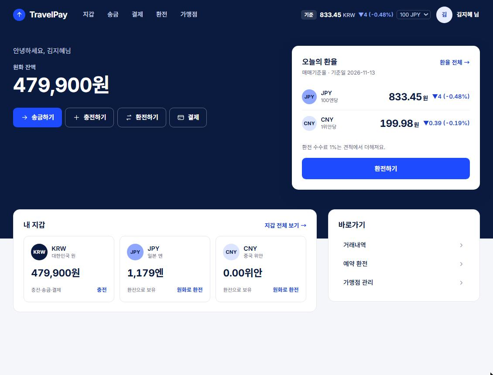
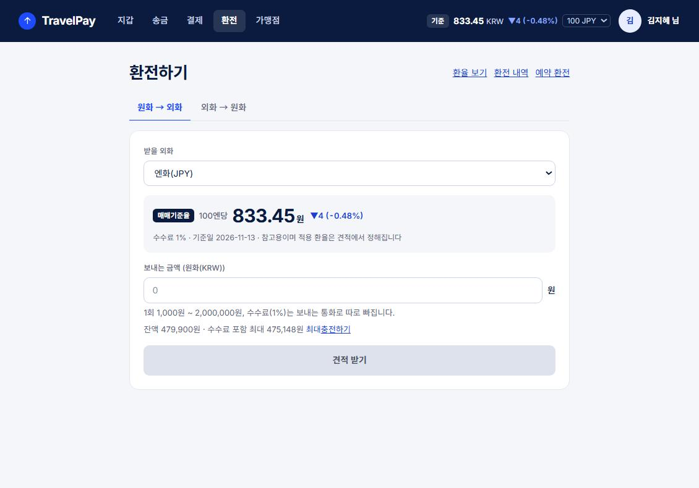
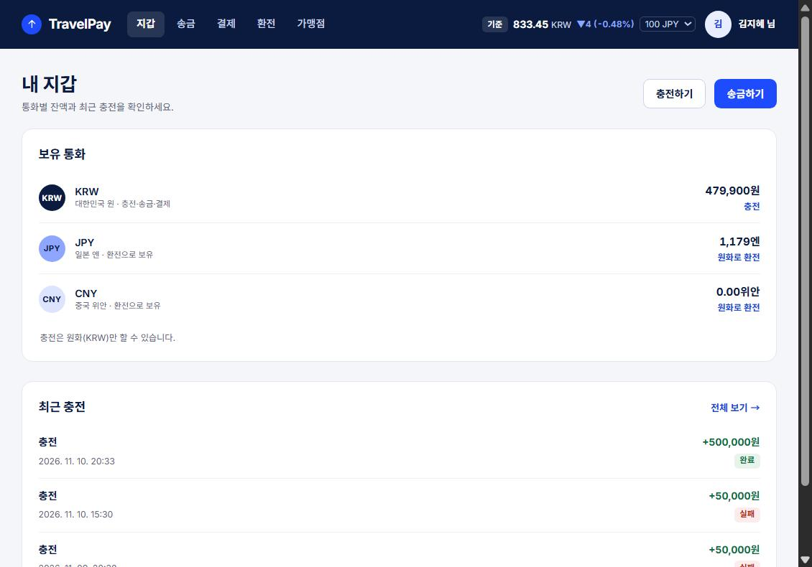
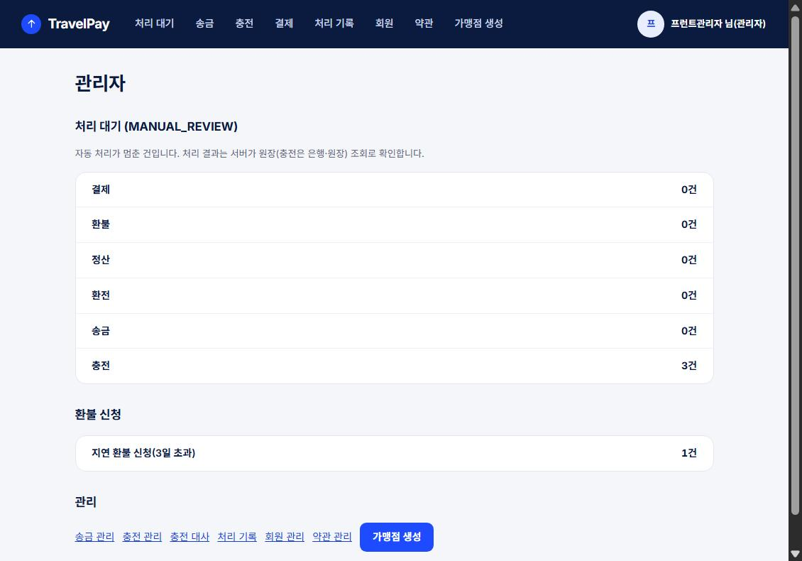

# TravelPay 프론트엔드

여행자용 지갑 서비스 TravelPay의 웹 화면입니다. 회원가입·로그인, 지갑·원화 충전, 회원 간 송금, 가맹점 결제·환불, 가맹점 정산, 환율 조회·환전·예약 환전과 관리자(`MASTER`) 화면을 제공합니다.

Vite + React 19 + TypeScript, 라우팅은 react-router 7입니다. 모든 API는 Gateway(`/api/v1/**`)를 거쳐 호출합니다. 백엔드는 별도 저장소(`travelpay`)입니다.

운영 주소는 `https://travelpay.store`(Vercel), API는 `https://api.travelpay.store`입니다. 자세한 내용은 [배포](docs/guide/deployment.md)를 봅니다.

## 화면

| 홈 | 환전하기 |
|---|---|
|  |  |
| **내 지갑** | **관리자 대시보드** |
|  |  |

로컬 테스트 데이터로 찍은 화면입니다. 전체 16장은 [브라우저 화면 확인 › 화면 스크린샷](docs/verification/browser-check.md#화면-스크린샷-2026-11-13)에 있습니다.

## 빠른 시작

Node 20.19 이상이 필요합니다. 화면을 실제로 쓰려면 백엔드(Gateway와 필요한 서비스)가 떠 있어야 합니다. 처음이면 **[처음 실행하기](docs/getting-started.md)**를 순서대로 따라 합니다.

```bash
npm install
cp .env.example .env.local
npm run dev        # http://localhost:5173 (Gateway 기본 주소 http://127.0.0.1:8080)
npm test           # 백엔드 없이 도는 컴포넌트·단위 테스트
npm run build      # 타입 검사 + 빌드 (dist/)
```

## 문서

| 구분 | 문서 | 내용 |
|---|---|---|
| 시작 | [처음 실행하기](docs/getting-started.md) | 설치, 환경 변수, 백엔드 띄우는 순서, 테스트 계좌, 관리자 계정, 자주 나는 문제 |
| 가이드 | [화면 목록](docs/guide/screens.md) | 일반회원·관리자 화면 경로와 동작, 미구현·제약 |
| | [개발 가이드](docs/guide/development.md) | 폴더 구조, API 호출·금액·CSRF 규칙, 금전 요청 멱등성 |
| | [공통 API 규칙](docs/guide/api-common.md) | 응답 형식, 오류 코드, 세션·CSRF, 멱등성, CORS |
| | [테스트·검증 가이드](docs/guide/testing.md) | 테스트 실행·범위·작성 방법, PR 전 확인 순서 |
| | [배포](docs/guide/deployment.md) | Vercel 설정·환경 변수, 도메인·DNS, Preview 제한, 배포 후 통합 검증 |
| 검증 기록 | [Gateway 경유 E2E](docs/verification/gateway-e2e.md) | 기능별 Gateway 경유 확인 결과, 발견한 문제, 확인하지 못한 것 |
| | [브라우저 화면 확인](docs/verification/browser-check.md) | 브라우저로 직접 확인한 범위, 화면 스크린샷 |
| | [로컬 검증 데이터](docs/verification/test-data.md) | 충전 보정·관리자 화면 확인용 데이터와 만드는 방법 |
| 규칙 | [브랜치](docs/convention/branch.md)·[커밋](docs/convention/commit.md)·[이슈·PR](docs/convention/issue-pr.md) | 협업 규칙 |
| | [스타일 가이드](docs/convention/style.md) | 디자인 토큰·글씨 크기·레이아웃·화면별 UI 규칙 |

기능별 API 명세와 오류 코드는 백엔드 `docs/guide/<서비스>.md`를 기준으로 합니다.

## 협업 규칙

- [브랜치](docs/convention/branch.md): 작업 브랜치는 `dev`에서 만들고 PR도 `dev`로 보냅니다.
- [커밋](docs/convention/commit.md): `type: 설명` 형식, 스코프 없음
- [이슈·PR](docs/convention/issue-pr.md): `.github/ISSUE_TEMPLATE/`, `.github/pull_request_template.md`
